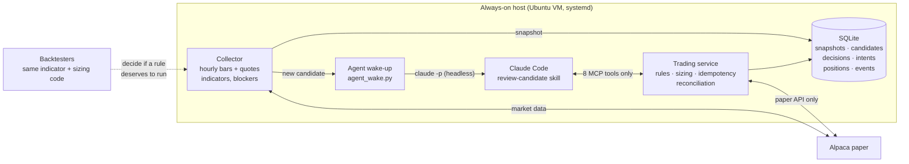

# trade-terminal

**A guarded, Claude-driven paper-trading agent, and an honest record of testing whether it can make money.**

The project started from a viral "AI trading bot turned $100 into $7,301" course. It rebuilds that bot with Claude
Code instead of a closed agent product, keeping the parts that matter:
- the AI makes judgement calls only;
- deterministic code owns money, size, limits and order safety;
- every decision traces back to the data it was based on.

The result: a working agent platform, and **three strategy tests that all failed under pre-declared rules**. The
README covers both.

> ⚠️ **Paper trading only.** There is no live-trading code path, by design. Nothing here is financial advice.

---

## Contents
- [What it does](#what-it-does)
- [Architecture](#architecture)
- [Safety design](#safety-design)
- [Results](#results)
- [Quickstart](#quickstart)
- [Project layout](#project-layout)
- [How the agent runs](#how-the-agent-runs)
- [Testing](#testing)
- [Not built (and why)](#not-built-and-why)
- [Lessons](#lessons)

## What it does
1. A **collector** wakes after each completed hourly bar. It pulls BTC/USD and ETH/USD bars and quotes from Alpaca,
   computes indicators, and saves a timestamped **snapshot** with data-quality **blockers**: stale quote, missing bar,
   quote/price mismatch, clock skew, open position, unresolved order.
2. If the mechanical rule fires, it queues a **candidate**: unique id, one owner, 15-minute expiry. It then wakes a
   **headless Claude Code run**.
3. Claude can use only eight **MCP tools**. It claims the candidate, inspects the evidence, and records **ENTER or
   SKIP** with a reason and evidence ids.
4. On ENTER, the **service** sizes and prices the order itself:
   - quantity from a $0.50 loss budget, capped at $25, rounded down to venue increments;
   - an IOC limit that never chases price;
   - an idempotent client order id, saved before sending;
   - reconciliation of the actual fills, partial fills and timeouts against the broker.
5. In the default **shadow mode**, step 4 is refused on purpose. Claude's decisions are recorded so they can be
   compared with "take every signal".
6. **Backtesters** replay years of data through the *same* indicator and sizing code, with measured costs, to decide
   whether a rule deserves to run at all.

## Architecture


The roles map onto UiPath concepts:

| Component | File(s) | In UiPath terms |
|---|---|---|
| Rules & limits | `RULEBOOK.md`, `config/*.yaml` | Config file |
| Collector | `terminal/collector.py` | Dispatcher |
| Candidate queue | `candidates` table | Orchestrator queue (unique reference, owner, deadline) |
| Trading service | `terminal/service.py`, `execution.py`, `sizing.py` | Business-rule layer with business exceptions |
| MCP server | `terminal/mcp_server.py` | The only "API" the robot may call |
| Claude + skill | `.claude/skills/review-candidate/SKILL.md` | Performer workflow (judgement step) |
| Agent wake-up | `terminal/agent_wake.py`, `config/agent.yaml` | Queue trigger → unattended job |
| Brokers | `terminal/broker/alpaca_paper.py`, `fake.py` | Target app + test double |

## Safety design
The AI is treated as an untrusted decision-maker inside hard limits. **Every limit is enforced in code, not prompts:**

| Risk | Control |
|---|---|
| Touching real money | Adapter hard-codes `paper=True` and asserts the paper URL. `live_trading: true` makes the process refuse to start |
| AI changes size/price/limits | Claude has no such parameter. `preview_order` computes qty and limit price; `submit_intent` sends exactly the preview |
| AI edits config, code, keys | Headless run: `--strict-mcp-config`, tools `mcp__trading,Skill,Read`, everything else denied (`--permission-mode dontAsk`). Keys live only in the service |
| Duplicate orders | Stable `client_order_id` per candidate, saved **before** sending. Atomic `PREVIEWED→SUBMITTING` flip, so a repeat submit never re-sends (verified on the paper account) |
| Uncertain submissions | Timeout → `UNKNOWN` → ask the broker by client id before anything else. Definite 4xx → `REJECTED` |
| Partial fills / fees in the asset | Position = broker-reported **sellable** qty (crypto fees are taken in the coin) |
| Bad or stale data | Blockers: quote > 15 s old, quote > ±2% from the bar close, clock skew, missing bars in the indicator window, unfinished candle excluded |
| Arguing past a failed check | ENTER with any blocker raises; the refusal text goes back to Claude verbatim, so it records SKIP |
| Overtrading | One position at a time; candidates expire 15 min after the bar closes; 2% daily loss halt (enforced in backtests; live enforcement belongs to the unbuilt supervisor) |
| Dust blocking the strategy | Remainders below the venue minimum are ignored by the one-position rule |
| Runaway agent | 25 turns max, 5-minute hard timeout, one run per new candidate, no polling |

## Results
Full write-up with method and tables: **[docs/FINDINGS.md](docs/FINDINGS.md)**.

| Test | Setup | Verdict |
|---|---|---|
| **Paper order cycle** | $12.49 BTC buy → sell through the real service path | ✅ Pass: no duplicate on re-submit, zero dust, round-trip cost measured at **0.54%** |
| **Agent run** | Real headless Claude Code, production command, fake broker | ✅ Pass: correct tool use, no denials, stopped at the shadow refusal. It also **found a data-quality gap**, now enforced in code |
| **C1** crypto 1h | 2022–2025, $100 | ❌ −43.8% development / −17.4% validation after costs. Pre-cost edge (+0.12%/trade) < costs (0.54%) |
| **C2** crypto 4h / 1d | Same rule, higher timeframes | ❌ 4h negative in both periods; daily untradeable at $100 ($10 venue minimum), negative in validation at $1,000 |
| **S1** 14 ETFs daily | 2016–2024, commission-free | ❌ Breakout entries did **worse** than a "just be long" baseline (t = −2.98 development) |

Holding SPY beat every active variant over the same periods: +$161.81 vs +$8.36 per $100 (2016–21).

**The most useful result was a method error caught in time.** The original S1 pass rule would have "passed" both
periods: long-only plus a rising market looks like an edge. A synthetic no-edge test exposed this before any real data
was fetched. The rule was amended and documented to require beating a "just be long" baseline.

## Quickstart
Full commands, hosting and troubleshooting: **[docs/RUNBOOK.md](docs/RUNBOOK.md)**.
```bash
bash deploy/setup_vm.sh                                   # Ubuntu 24.04: venv, deps, tests (73)
nano .env                                                 # Alpaca PAPER key + secret
.venv/bin/python scripts/check_connection.py              # read-only; places nothing
.venv/bin/python scripts/paper_smoke_test.py --yes        # ~$12.50 paper buy + sell, duplicate check
.venv/bin/python scripts/fetch_history.py && .venv/bin/python -m terminal.backtest --timeframes 1h,4h,1d
.venv/bin/python scripts/fetch_stocks.py  && .venv/bin/python -m terminal.backtest_stocks
```
Offline demo, no keys needed: `BROKER=fake .venv/bin/python -m terminal.collector --once`.

## Project layout
```
RULEBOOK.md                      strategy + limits in plain English (the agent reads this)
config/
  strategy.yaml  risk.yaml       rule parameters · limits, costs, execution_mode (shadow|paper)
  agent.yaml                     agent wake-up: enabled flag, tools, model, timeout
  backtest.yaml                  crypto test settings + experiment log
  backtest_stocks.yaml           S1 declaration, amendment and result
terminal/
  collector.py                   hourly loop: data → snapshot → blockers → candidate → wake agent
  service.py  execution.py       claim/decide · preview → submit → reconcile (state machine)
  sizing.py   indicators.py      pure functions shared by live code and backtests
  mcp_server.py                  the 8 tools Claude can call
  agent_wake.py                  headless Claude launcher (locked-down command)
  backtest.py backtest_stocks.py historical engines (crypto hourly; ETFs daily + baseline)
  broker/                        alpaca_paper.py (paper-pinned) · fake.py (deterministic test double)
scripts/                         check_connection · paper_smoke_test · fetch_history · fetch_stocks
deploy/                          setup_vm.sh · install_service.sh · systemd unit · gcp/oci VM creation
.claude/skills/review-candidate/ the agent's procedure
docs/                            RUNBOOK.md · FINDINGS.md
tests/                           73 tests, offline
```

## How the agent runs
```bash
timeout 300 claude -p "Use the review-candidate skill to review candidate <id>. Your owner id is agent-xxxx." \
  --mcp-config .mcp.json --strict-mcp-config \
  --allowedTools mcp__trading,Skill,Read \
  --disallowedTools Bash,Edit,Write,NotebookEdit,WebFetch,WebSearch,Task,Agent \
  --permission-mode dontAsk --max-turns 25 --output-format json --model sonnet
```
The eight tools are `read_account`, `list_candidates`, `inspect_candidate`, `claim_candidate`, `record_decision`,
`preview_order`, `submit_intent` and `get_intent`. **Why not Alpaca's own MCP server?** It exposes raw order
placement at any size. Here, the model can only choose ENTER/SKIP; quantities and prices come from the service.

## Testing
`.venv/bin/python -m pytest -q` runs 73 offline tests against a deterministic fake broker. They cover:
- **No lookahead:** truncating future data never changes past signals; unfinished candles are excluded.
- **Data blockers:** stale or mismatched quotes, gaps, clock skew.
- **Queue:** ownership and expiry.
- **Order state machine:** full, partial and no fills; timeout before and after sending; definite rejection; repeat
  submits; expired previews.
- **Sizing:** loss budget, position cap, venue minimums, dust.
- **Shadow mode:** decisions are recorded and no order is ever created.
- **Agent:** the command is locked down and starts in the background.
- **Backtest mechanics:** stop before target, gap fills, time exits in trading days, Friday-signal → Monday-open
  entry, baseline comparison, refusal to guess a missing cost.

## Not built (and why)
- **Position supervisor / automated exits, daily-halt enforcement live.** Only needed once a rule passes. Until then
  shadow mode creates no positions.
- **Streamlit dashboard.** Same reason. SQLite + `journalctl` are enough for shadow runs.
- **Live trading.** Deliberately impossible in this codebase.
- **Earnings-drift strategy + AI classification.** The most plausible next idea (see FINDINGS). Its AI component can
  only be measured prospectively, not backtested honestly.

## Lessons
1. **Edge ÷ cost decides everything at small scale.** A 0.12% edge can't survive a 0.54% round trip.
2. **Benchmark long-only rules against "just be long".** Otherwise a bull market looks like skill.
3. **Declare the test before running it, and keep every run.** Picking the best of 54 grid results would have
   "found" a strategy. It wasn't done.
4. **Give the AI judgement, not authority.** The bot's most useful act was flagging bad data. The fix belonged in code.
5. **Measure costs on the real venue.** The paper smoke test pinned the model to reality (0.54% measured vs 0.63% modelled).

---
*Built with Claude Code, November 2026. Paper trading only.*
